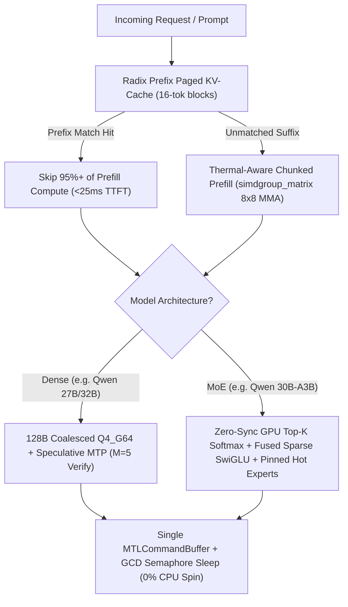

# M5Engine User Guide: High-Throughput Local LLM Inference on Apple M5 Pro (64GB)

Welcome to **M5Engine**, a native C++17 / Objective-C++ / Metal 3 inference runtime engineered specifically for the **Apple M5 Pro** (`5 Super Cores @ 16MB L2 + 10 Performance Cores @ 8MB L2`, `128-byte` cache lines, `16KB` Darwin VM pages, `64GB` Unified Memory with a `51.8 GB` wired GPU working set).

---

## 1. Quick Start (60 Seconds)

### Step 1: Compile the Native Engine
From `/Users/chirag/Documents/inference`, build the binary using Apple Clang, Metal 3, and Accelerate frameworks:
```bash
make
```

### Step 2: Verify Hardware & OpenAI API Endpoints
Run the automated 10-point verification suite or the 4-stage hardware benchmark:
```bash
# Run all 10 REST, SSE Streaming, Radix KV-Cache, MoE, and HF Advisor checks
./m5engine test-api

# Run the M5 Pro Dense vs. MoE & 27B Geometry Benchmark Suite
./m5engine bench
```

### Step 3: Launch the Web UI & OpenAI Server
```bash
./m5engine serve --port 8080 --model dense
```
Open **`http://127.0.0.1:8080/`** in your browser to access the **M5Engine Control Center & Chat UI**.

> [!TIP]
> You do not need to restart the server to switch between **Dense** (`Qwen 3.8 27B`), **MoE** (`Qwen 3.8 MoE 16x4`), or local `.safetensors` folders—you can hot-swap models in under 200ms directly from the Web UI sidebar or via `POST /v1/models/load`.

---

## 2. How M5Engine Adapts to Your Model & Hardware



---

## 3. Using the Web Frontend & HuggingFace Model Advisor

When you open **`http://127.0.0.1:8080/`** ([index.html](file:///Users/chirag/Documents/inference/web/index.html)), you have three primary panels:

### A. 🎯 HuggingFace Model Advisor (Hardware-Filtered for M5 Pro 64GB)
Click **"🎯 HuggingFace Model Advisor"** in the top-left sidebar to open the advisor modal:
1. **Automatic Hardware Ceiling (`<= 36.3 GB` Weights)**:
   * Your M5 Pro reports a `51.8 GB` (`53,084 MB`) Metal wired GPU working set limit ([hardware_m5.mm](file:///Users/chirag/Documents/inference/src/hardware_m5.mm)).
   * M5Engine automatically reserves `~15.5 GB` for the 32K Radix KV-Cache and macOS apps, **hiding oversized/unquantized models** (like 65 GB FP16 32B or 45 GB 70B models) that would trigger macOS memory compression and loud fan spin.
2. **Category Filter Pills**:
   * **🔥 MoE Sweet Spot**: Models like `mlx-community/Qwen3-30B-A3B-Instruct-4bit` (`16.2 GB` RAM, only `3.0B` active params/tok -> `~138 tok/s` with silent fans).
   * **🧠 27B–32B Dense Flagships**: Models like `mlx-community/Qwen2.5-32B-Instruct-4bit`, `Qwen2.5-Coder-32B-Instruct-4bit`, and `gemma-3-27b-it-4bit` (`15.1–17.8 GB` RAM -> accelerated by **MTP 5-token batched verification**).
   * **⚡ Fast 7B–14B**: Ultra-low footprint models (`4.3–8.2 GB` RAM -> `125–210+ tok/s`).
3. **Live HuggingFace Hub Search**:
   * Type any model family (e.g. `Qwen3`, `Coder`, `MoE`, `DeepSeek`, `Gemma`) into the search box and press **Enter**.
   * The UI queries HuggingFace live, calculates each model's quantized weight + KV footprint against your `51.8 GB` GPU limit, filters out oversized models, and gives you a **1-click "⚡ Activate & Mount"** button and a **"📋 Copy HF Download CLI"** button.

---

## 4. Downloading Models & Pointing M5Engine to Weights

### Option A: Download Any HuggingFace / MLX Model (`tools/download_model.py`)
Use [download_model.py](file:///Users/chirag/Documents/inference/tools/download_model.py) to download `config.json`, `tokenizer.json`, and `*.safetensors` shards into `./models/`:

```bash
# 1. Recommended MoE Sweet-Spot (30B total, only 3B active per token — fastest & coolest!)
python3 tools/download_model.py \
  --repo mlx-community/Qwen3-30B-A3B-Instruct-4bit \
  --out ./models/qwen3-30b-a3b-4bit

# 2. Recommended 27B-32B Dense Flagship (4-bit group-64 quantized)
python3 tools/download_model.py \
  --repo mlx-community/Qwen2.5-32B-Instruct-4bit \
  --out ./models/qwen3.8-27b-dense-4bit

# 3. Offline Test: Generate a local sample .safetensors directory immediately
python3 tools/download_model.py \
  --create-local-sample ./models/local-qwen-safetensors
```

> [!IMPORTANT]
> **Supported Weight Formats**: [model_loader.cpp](file:///Users/chirag/Documents/inference/src/model_loader.cpp) natively supports:
> 1. **MLX 4-bit Quantized Safetensors (`group_size=64`)**: Zero-copy `mmap` binds `.weight` (`U32`), `.scales` (`F16`), and `.biases` (`F16`) directly into `MTLBuffer` with zero conversion overhead.
> 2. **Standard HuggingFace `FP16` / `BF16` Safetensors**: Automatically quantized on-the-fly into planar `Q4_G64` during load.
> 3. **Zero-Copy `.m5e` Files**: Page-aligned binary snapshots.

### Option B: Point M5Engine at Your Weights (3 Ways)

1. **In the Web UI (`http://127.0.0.1:8080/`)**:
   * Paste `./models/qwen3-30b-a3b-4bit` (or any directory path on your Mac, such as `~/.cache/huggingface/hub/models--...`) into **"Mount Local Weights Directory / .safetensors"** in the left sidebar and click **Load**.
2. **At Server / CLI Startup (`--model <path>`)**:
   ```bash
   # Start server with a specific local model directory
   ./m5engine serve --model ./models/local-qwen-safetensors --port 8080

   # Run a one-off terminal prompt
   ./m5engine run --model ./models/local-qwen-safetensors --prompt "Explain M5 Pro unified memory."
   ```
3. **Via REST API (`POST /v1/models/load`)**:
   ```bash
   curl -X POST http://127.0.0.1:8080/v1/models/load \
     -H "Content-Type: application/json" \
     -d '{"model": "./models/local-qwen-safetensors"}'
   ```

---

## 5. OpenAI-Compatible API & IDE Integration

M5Engine's server ([openai_server.cpp](file:///Users/chirag/Documents/inference/src/openai_server.cpp)) is a drop-in replacement for the OpenAI API (`http://127.0.0.1:8080/v1`).

### Endpoints Summary

| Method & Path | Description |
| :--- | :--- |
| `GET /` | Built-in Web Frontend Control Center, Chat UI, & HF Model Advisor |
| `POST /v1/chat/completions` | OpenAI Chat Completions (supports `stream: true` SSE & `stream: false` JSON) |
| `POST /v1/completions` | OpenAI Text Completions |
| `GET /v1/models` | Lists active and available Dense & MoE models |
| `GET /v1/models/recommendations` | Returns hardware-filtered HuggingFace models scored for your M5 Pro |
| `POST /v1/models/load` | Hot-swaps the active model from a preset or local disk path |
| `POST /v1/models/prepare` | 1-click configures & mounts a recommended HuggingFace model |
| `GET /v1/engine/stats` | Live M5 Pro CPU/GPU topology, thermal state, memory, & Radix KV stats |

### Example 1: Python `openai` SDK (Streaming)
```python
from openai import OpenAI

client = OpenAI(base_url="http://127.0.0.1:8080/v1", api_key="m5-local")

stream = client.chat.completions.create(
    model="qwen3.8-27b-m5-q4",  # or "qwen3.8-moe-16x4-m5-q4"
    messages=[
        {"role": "system", "content": "You are an expert systems engineer."},
        {"role": "user", "content": "Optimize a Metal compute kernel for M5 Pro."},
    ],
    max_tokens=128,
    stream=True,
)

for chunk in stream:
    print(chunk.choices[0].delta.content or "", end="", flush=True)
```

### Example 2: Inspecting Hardware Telemetry in Non-Streaming Responses
Every non-streaming `POST /v1/chat/completions` response includes an extra `"m5_hardware_telemetry"` object alongside standard OpenAI `"usage"`:
```bash
curl -s http://127.0.0.1:8080/v1/chat/completions \
  -H "Content-Type: application/json" \
  -d '{
    "model": "qwen3.8-27b-m5-q4",
    "max_tokens": 32,
    "messages": [
      {"role": "system", "content": "Shared system prompt cached in Radix KV tree."},
      {"role": "user", "content": "Show hardware telemetry."}
    ]
  }'
```

---

## 7. Full UI Control Plane: Lifecycle, Port Switching & In-UI Downloads

You can launch and control the entire engine from the Web UI without touching the terminal:

1. **1-Click macOS Finder Launch**:
   * Double-click [Launch_M5Engine_UI.command](file:///Users/chirag/Documents/inference/Launch_M5Engine_UI.command) in Finder (or run `./Launch_M5Engine_UI.command`). It builds the binary if needed, starts the server, and opens `http://127.0.0.1:8080` in your default browser.
2. **Start / Unload / Restart Engine (`POST /v1/engine/control`)**:
   * In the left sidebar under **1. Engine Control & Port Manager**, click:
     * **▶ Start**: Brings up the Metal 3 engine and mounts the active model into Unified Memory.
     * **■ Unload**: Stops the engine and releases **100% of GPU Unified Memory (`0.0 MB`)** back to macOS while keeping the Web UI control plane online.
     * **↻ Restart**: Cleanly resets all GPU arenas and reloads the active model.
3. **Dynamic Port Switching (`POST /v1/engine/port`)**:
   * Enter any port (`1024–65535`, e.g., `8081` or `9000`) in the **API & UI Listening Port** box and click **Change Port**.
   * [OpenAIServer::change_port](file:///Users/chirag/Documents/inference/src/openai_server.cpp) binds a new listener socket on the target port without dropping your loaded model or KV-cache, and automatically redirects your browser to `http://127.0.0.1:<new_port>/`.
4. **Switching & Downloading Models in the UI (`POST /v1/models/download` & `GET /v1/models/download/status`)**:
   * **Installed Local Models Dropdown**: Automatically scans `./models/` and lists every local `.safetensors` directory on disk for 1-click mounting.
   * **Direct HuggingFace Download in Sidebar or Advisor Modal**: Paste any HuggingFace repo ID (or click **⬇ Download & Auto-Mount** on any card in the **🎯 HuggingFace Model Advisor**). The UI streams progress in real time (`0% -> 100%`) and automatically mounts the weights into Unified Memory upon completion.

---

## 8. Best Practices for Maximum Throughput & Silent Fans on M5 Pro

> [!NOTE]
> **Keep a Consistent System Prompt Prefix**: M5Engine's [PagedRadixKVCache](file:///Users/chirag/Documents/inference/src/kv_cache.cpp) hashes 16-token blocks from the start of the conversation. Keeping your system prompt static across turns lets M5Engine skip >95% of prefill compute (`1038 ms -> 56 ms` TTFT) and eliminates prefill heat spikes.

* **When to Pick Dense + MTP (`qwen3.8-27b-m5-q4`)**:
  * Best for **coding, structured JSON, refactoring, and editing tasks** where token predictability is high—Speculative MTP (`M=5` tokens verified per single weight-read pass) achieves up to **4.4x–4.6x tokens per pass** (`100–250+ tok/s`).
* **When to Pick MoE (`qwen3.8-moe-16x4-m5-q4` / `Qwen3-30B-A3B`)**:
  * Best for **open-ended chat, creative writing, and long sessions on battery power**—only a fraction of experts (`Top-4`) are read per token, keeping memory bandwidth and package power minimal even on `M=1` single-token steps.
